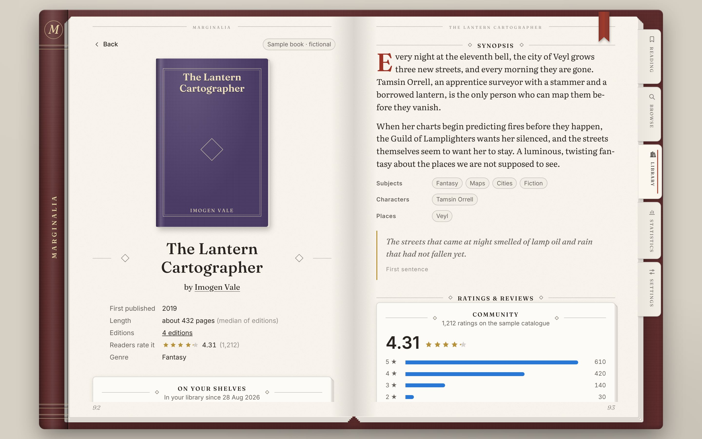
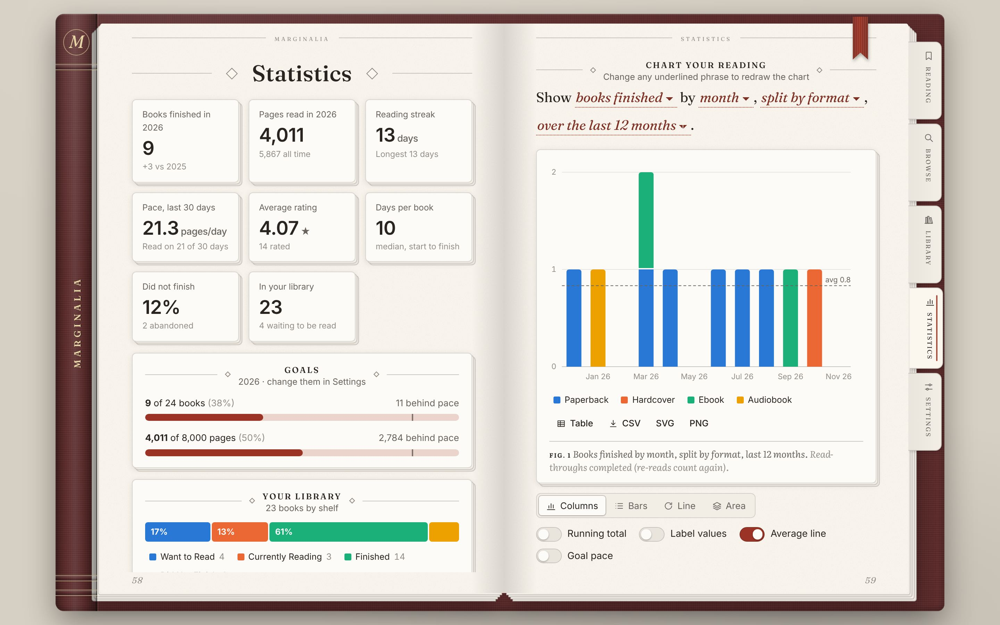
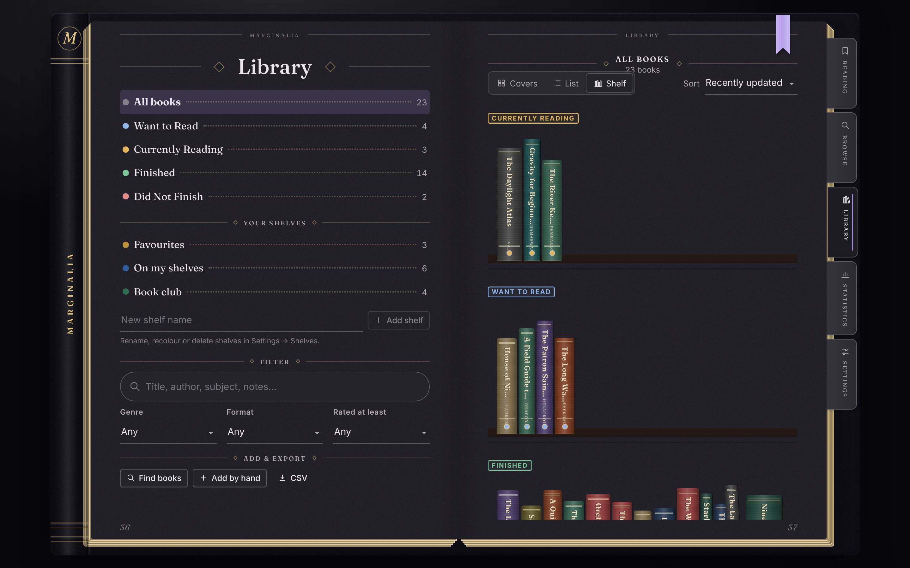
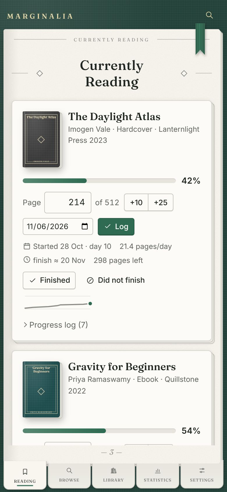
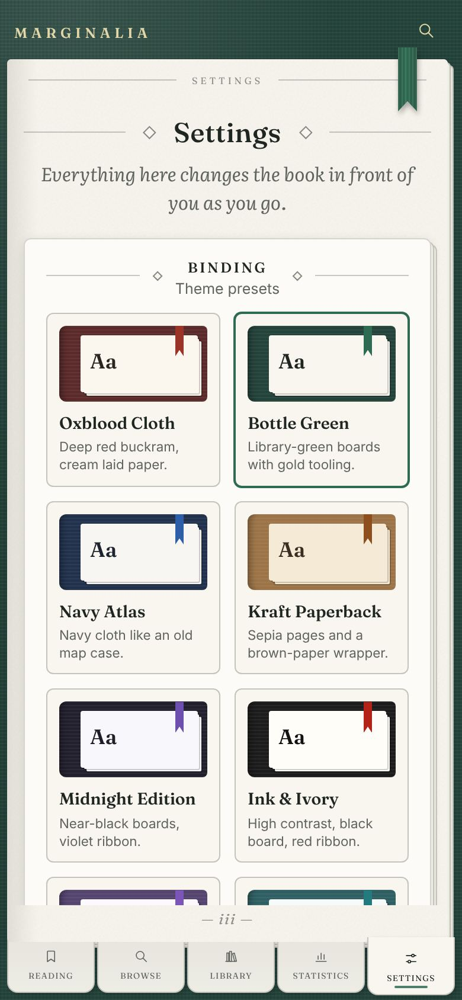

# Marginalia

A reading tracker laid out like a book. Browse any book on Open Library by title or author, shelve it as
Want to Read, Currently Reading, Finished or Did Not Finish (every move dated), track the page you're on,
and chart your reading with a statistics page you can reshape and filter.



| | |
|---|---|
|  |  |
|  |  |

## What it does

### Browse every book
- Search [Open Library](https://openlibrary.org) across everything, or by **title**, **author** or **ISBN**, with optional
  first-published years and language. Sort by relevance, most read, highest rated, most editions, newest or oldest.
- Browse sixteen subject shelves and the weekly trending list, or click any author to see their books.
- Each book has its own page showing:
  - **synopsis**, subjects, characters, places and the opening line;
  - **reviews**: the community's average rating with its 1–5★ distribution and reader counts, plus your own rating
    (half stars) and written review, with an optional spoiler blur;
  - **every edition** with publisher, year, format, language, ISBN and **page count** (sortable and filterable). Pick
    the one you own and its page count drives your progress;
  - first publication, median length, edition count, genre and an author card.
- Not on Open Library? Add a book by hand.

### Shelves, with dates
- The four reading shelves are exclusive: **Want to Read**, **Currently Reading**, **Finished**, **Did Not Finish**.
  Each move is dated (added, started, finished, stopped), and every date is editable.
- Each book keeps a **reading history** of read-throughs. You can re-read a book, resume one you abandoned, or log
  reads from the past. Undo is offered after every move.
- **Custom shelves** (Favourites, Book club…) have their own colours and sit alongside the four reading shelves.
- The library has three views: **cover grid**, **list**, and **spines standing on shelves**. It also has search,
  genre, format and rating filters, seven sort orders and CSV export.

### Reading, page by page
- Log the page you're on, or a percentage, with quick +10 / +25 buttons. You can log for an earlier day.
- Each book shows pages left, your pace, a projected finish date, a sparkline of progress and a deletable progress
  log. It offers to mark the book finished when you reach the last page.
- The Reading page also shows today's pages, your reading streak, the last 30 days, your yearly goal against pace,
  what's up next and what you finished recently.

### Statistics
- **Overview:** books and pages this year (vs. last year), streaks, pace, average rating, days per book, DNF rate,
  goal meters with an "even pace" marker, a part-to-whole bar of your library by shelf, highlights (favourite genre,
  most-read author, busiest month, longest and shortest books) and a **reading calendar** of pages per day.
- **Chart builder:** a sentence you edit in place, for example *"Show [books finished] by [month], [split by
  format], [over the last 12 months]."*
  - **Measures (9):** books finished, pages read, books started, added, abandoned, library size, average
    rating, days to finish, pages per day.
  - **Groupings (14):** day, week, month, quarter or year, or genre, author, rating, shelf status, format,
    book length, publication decade, custom shelf or weekday.
  - **Splits:** stack the data by status, format, genre, shelf or length.
  - **Display:** column, bar, line or area; running totals; value labels; an average line; a yearly-goal pace line;
    top-N for ranked groupings.
  - **Dates and filters:** date presets or a custom range, filtered by status, format, shelves, genres, author,
    minimum rating and page range.
  - **Reading and export:** tooltips (keyboard too), legend toggles, a table view, CSV/SVG/PNG export, and your own
    saved charts.

### The design
The interface is a book on a desk. Cloth cover boards and a spine with raised bands hold a block of stacked pages
(the leaves underneath show at the fore-edge and tail). Index tabs stand out from the fore-edge, and a ribbon
bookmark hangs over the head of the page. Pages carry running heads and folios. On wide screens each section opens
as a two-page spread, and moving between sections turns the page. Panels are loose leaves with their own small
stacks. Headers and panel sections are marked by **pale horizontal rules, vertically centred on the heading text**,
with optional diamond ornaments.

### Customisation (Settings)
| Area | Options |
|---|---|
| Binding | 8 themes (Oxblood Cloth, Bottle Green, Navy Atlas, Kraft Paperback, Midnight Edition, Ink & Ivory, Lavender Folio, Sea Glass); match device, light or dark |
| Colours | your own cover, paper, ink, ribbon, desk, lettering and gilt colours per mode, with a live text-contrast check |
| Type | heading, reading and interface fonts (10 choices each), text size, line spacing |
| Pages & layers | leaves under the page (0–7) and their spacing, leaves under panels, shadow depth, plain/gilded/sprayed edges, paper (smooth, grain, laid, ruled, dot grid), cover (cloth, linen, leather, smooth), rounded/square/dog-eared corners, ribbon, running heads, page numbers |
| Headings & rules | solid/double/dashed/dotted/fading lines, weight, paleness, ink/ribbon/gilt colour, centred or left headings, small caps/capitals/as written, ornaments |
| Layout & motion | index tabs or spine navigation, two-page spreads or single page, four book sizes, three densities, page turn/slide/fade/instant |
| Reading | pages or percentages, usual format, six date formats, week start, stars/hearts/numbers, half stars, finish prompt, spoiler blur |
| Goals | books and pages per year |
| Shelves | create, rename, recolour, delete |
| Books & covers | Open Library on/off, real covers or cloth bindings, search language, results per page, chart colours |
| Your data | JSON backup and restore (merge or replace), Goodreads/StoryGraph CSV import, sample library, erase everything |

## Running it

```bash
cd Marginalia
npm install
npm run dev        # http://localhost:5173
npm test           # unit tests (Vitest)
npm run build      # type-check + production build into dist/
npm run e2e        # end-to-end smoke test against the build (needs Playwright, see below)
```

`dist/` is a static site with relative paths and hash routing, so it works from any static host or a sub-folder
(for example GitHub Pages). Once hosted, it can be installed to a phone's home screen. The service worker keeps
the app and recently seen covers available offline.

`npm run build:single` produces one self-contained `dist-single/index.html` (fonts load from Google Fonts) that is
handy for sharing a preview.

The smoke test (`e2e/smoke.mjs`) drives the built app in Chromium through browse, book page, shelving, editions,
logging pages, finishing, library, statistics, review, settings, export and offline search. Open Library is
replaced by fixtures in its documented response shapes. It needs `playwright` (`npm i -D playwright && npx playwright install chromium`).

## How it is built

React 19 + TypeScript + Vite. It uses no UI, state or chart libraries: the book shell, controls and SVG charts are
written for this app, and the fonts are self-hosted via Fontsource.

```
src/
  api/openlibrary.ts   Open Library client: search, trending, works, editions, ratings, reader counts, authors;
                       defensive mapping, memory + localStorage cache, stale-on-error fallback
  api/catalog.ts       one interface over Open Library, the sample catalogue and hand-added books
  data/model.ts        app state, sanitising of anything loaded or imported
  data/reducer.ts      all state changes; shelf transitions and dated read-throughs live here
  data/settings.ts     settings, themes, fonts, theme → CSS variables (including the page-stack shadows)
  data/importCsv.ts    Goodreads / StoryGraph CSV import
  data/sample.ts       the sample catalogue: invented books, authors and publishers
  stats/engine.ts      statistics: page attribution, streaks, overview, chart series, calendar
  components/          book shell, rule headings, leaves, covers, chart, heatmap, menus, toasts
  pages/               Reading, Browse, Book, Library, Statistics, Settings
tests/                 Vitest unit tests (reducer, stats, Open Library mapping, dates, CSV import)
e2e/                   Playwright smoke test and screenshot helper
```

**Your data** stays in the browser's `localStorage` (key `marginalia:v1`), saved as you go and synced between open
tabs. Export a backup from Settings to move it between browsers.

**Shelves and dates.** Each book keeps a list of read-throughs (start date, finish/stop date, outcome and a log of
page updates). The shelf you see is the latest read-through, except that a finished book can go back on Want to
Read for a re-read without losing its history.

**Pages read** are counted from your page logs (only forward movement counts, so corrections don't double count).
A finished read with no logs has its pages spread evenly over its start-to-finish dates, or put on the finish date
if the start is unknown.

**Charts** follow a few rules:
- Single series use one colour.
- Multi-series charts use a colour-blind-safe categorical palette in a fixed order, and a series keeps its colour
  when filters change.
- Book-length tiers use a one-hue ordinal ramp.
- The palette and ramps were validated against this app's paper colours in light and dark mode. Some light-mode
  hues sit below 3:1 contrast, so every chart has a table view.

## Notes

- **Reviews:** Open Library publishes ratings and reader counts but not written reviews, so the community side of a
  book page shows those and the written review is your own. Showing other readers' reviews would need a server,
  or a review service with an API key.
- **Open Library from the browser:** the app calls `openlibrary.org` and `covers.openlibrary.org` directly. When they
  can't be reached it says so and falls back to your library and the sample catalogue. The build environment for
  this project couldn't reach Open Library, so the integration is tested against fixtures in its documented shapes.
  Do a quick real search on first run.
- **Sample library:** the books, authors, publishers, ratings and reviews in the sample are invented. Remove them
  in Settings → Data.
